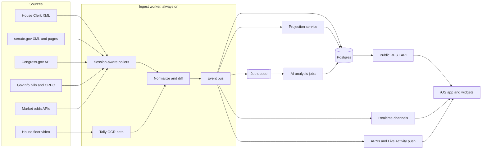

# Floor: live federal vote tracker — implementation plan

iOS-first. Where every number on screen comes from, the backend that turns government feeds into live updates, how the AI "What it means for you" summaries work, and the order we build it in.

Designs: v2 "Live + impact" canvas (Home, Live vote, Bill, Rep, Live Activity). Rendered version of this plan: [`plan.html`](plan.html).

## Key decisions

| Decision | Why |
|---|---|
| **Native SwiftUI, iOS 17.2+** | Live Activities, Dynamic Island and widgets are the core of the "sports app" feel. They need ActivityKit and WidgetKit. |
| **Official sources first** | House Clerk, Senate LIS, Congress.gov and GovInfo are free and authoritative. Third-party data covers two gaps only: district geocoding as a second option, and display-only market odds. |
| **Always-on ingest worker** | Votes need polling every 5–15 s while a chamber is in session. Minute-level serverless crons are too slow. |
| **Postgres + realtime channels** | One system of record. Live state reaches open apps over realtime channels and closed apps via APNs and Live Activity pushes. |
| **AI analysis per bill, personalization per profile** | Each bill version is analyzed once, with section citations. "For you" combines that analysis with coarse profile attributes. No names or addresses go to the model. |
| **Projections are ours; odds are display-only** | In-house "% projected to pass" for every vote. Market prices appear only where a market exists, labeled by source, never linked to trading. |

## What "live" can mean for each chamber

| On screen | House | Senate | Design consequence |
|---|---|---|---|
| "Vote is open" | Near-live: Clerk floor summary / live.house.gov | Near-live: Senate floor activity pages (scraped) | Start the Live Activity and push from floor events |
| Running Yea/Nay + clock | Experimental: only on the vote board in the public House floor video (OCR) | Not available (voice roll call, no board) | House: OCR beta; when OCR is off, show "Voting open". Senate: projection + "results when the clerk posts" |
| Each member's vote | After close: Clerk roll call XML, minutes after the gavel | After close: senate.gov roll call XML | "Your rep voted" arrives minutes after close; before that, show announced positions labeled as statements |
| Play-by-play | After close: rebuilt from the roll call | After close | Live shows floor events only; after close, a "How it unfolded" recap |
| Bills, summaries, cost | Hours: Congress.gov, GovInfo, CBO | same | Fine for bill pages and AI |

**Design change needed:** replace the live per-member play-by-play with floor events. Show your rep as "Pending · posts after the vote" until the roll call lands. The OCR tally gets validated in M3.

## Data sources

| Data | Source | Access | Freshness |
|---|---|---|---|
| District from address | U.S. Census Geocoder (current Congressional Districts layer); second option: Geocodio (paid) | REST, no key | Static |
| Members, terms, committees, ID crosswalk | `unitedstates/congress-legislators` + Congress.gov `/member` | YAML/JSON, REST | Daily |
| Bills, actions, cosponsors, CRS summaries, CBO | Congress.gov API v3 | REST, api.data.gov key | Hourly |
| Bill text (each version) | GovInfo API + bulk `BILLS` / `BILLSTATUS` | REST/bulk, key | Daily |
| House roll calls (per member) | Clerk EVS XML `clerk.house.gov/evs/{year}/roll{nnn}.xml`; Congress.gov `/house-vote` (beta) for backfill | XML / REST | Minutes after close |
| Senate roll calls (per member) | senate.gov LIS vote XML | XML | After close |
| House floor events | Clerk floor summary XML / live.house.gov | XML polling | ~10–30 s |
| Senate floor events | senate.gov floor activity + press gallery pages | HTML scrape | ~1 min |
| House running tally (beta) | Public House floor video; OCR of the vote board | Video + OCR | ~5 s |
| Upcoming votes | docs.house.gov floor schedule XML; Senate calendars | XML / PDF | Daily |
| Voting history / ideology | Voteview (DW-NOMINATE, all roll calls) | CSV bulk | Weekly |
| Announced positions | Member press-release RSS, Congressional Record (GovInfo `CREC`) + AI extraction | RSS / XML | ~15 min |
| Local context for "for you" | Census ACS 5-year API, FCC National Broadband Map, topic datasets (HUD, BLS) | REST / bulk | Yearly |
| Market odds (optional, display-only) | Kalshi / Polymarket public read-only market data | REST, no auth for reads | ~1 min |
| AI analysis | Anthropic Claude API (server-side only) | API key | On each new bill version |

**Avoid:** Google Civic Information Representatives API (shut down in 2025) and the ProPublica Congress API (discontinued).

## Backend architecture

**Recommended stack**

- **Language:** TypeScript monorepo (worker, API, shared types). Swift models are hand-written against the committed OpenAPI contract and checked against it in CI (generation was tried in M2 and dropped; see `HANDOFF.md`).
- **Database, auth, realtime:** Supabase (Postgres, Sign in with Apple, row-level security, realtime broadcast).
- **Ingest worker:** one small always-on container (Fly.io or Railway) running the pollers, OCR, the event bus and APNs sends.
- **Jobs:** `pg-boss` queue inside Postgres.
- **Public API:** Hono on Vercel (Node runtime), CDN-cached reads.
- **Observability:** Sentry and an alert whenever a source goes stale.

## Live vote pipeline

1. **Session detection:** poll every 10 s while a chamber is in session; back off to every 5 min otherwise.
2. **Vote opens:** a floor event creates a `vote` row (`open`) linked to the bill, with vote type and threshold (majority, 3/5 cloture, 2/3 suspension).
3. **Fan-out:** a realtime broadcast goes to open apps; followers get an APNs push-to-start Live Activity (iOS 17.2+); others who opted in get a notification.
4. **During the vote:** House OCR updates the score and clock every ~5 s; projections recompute on each update.
5. **Vote closes:** poll for the roll call XML every 10 s, parse positions, check against the OCR totals, set `final`.
6. **Personal results:** "Your rep voted Yea · it passed 219–208" plus a one-line "for you"; the Live Activity ends with the final state.

Targets: floor event to push under 30 s; roll call posted to "your rep voted" under 60 s; OCR tally to Live Activity under 10 s.

## AI: bill impact and "What it means for you"

- **Layer 1, per bill version (shared):** inputs are bill text, CRS summary, CBO estimate and committee report. The output is structured JSON: purpose, key provisions, cost, affected groups with direction, supporter and opponent arguments, and impact rules keyed by profile attributes. Every claim cites a bill section. Models: Claude Sonnet 5.5 for analysis, Claude Haiku 5.5 for tagging and citation checks.
- **Layer 2, per user:** the profile is coarse and opt-in (district, county; optionally renter or owner, income band, veteran, student, parent, age band, work sector). Rules are matched to the profile and filled with county statistics, then a short model call writes the paragraph. Results are cached by profile bucket. No names, emails or street addresses go to the model.
- **Guardrails:** a neutrality rubric, a claim-vs-citation verifier pass, a ~50-bill eval set, human review of the top 20 bills each week, an "AI summary · may contain errors" label, source links and feedback buttons.

## Projection model

- **Pre-vote:** per-member Yea probability from party and leadership position, cosponsorship, committee vote, rule vote, DW-NOMINATE distance, similar past votes and announced positions.
- **Aggregate:** Monte Carlo over the chamber, apply the threshold, report pass probability and projected tally.
- **Live:** update on running totals and new statements.
- **Validation:** backtest on 118th–119th Congress roll calls, publish calibration, beat a party-line baseline on Brier score.
- **Market odds:** a secondary sourced line only where a market clearly matches; no trading links.

## iOS app

- SwiftUI + Observation, Swift 6, minimum iOS 17.2.
- ActivityKit (Live Activity + Dynamic Island), WidgetKit, App Intents.
- Swift Charts, SwiftData offline cache, Supabase Swift SDK (auth + realtime), Sign in with Apple.
- Packages (one `FloorKit` Swift package, one library per area): `Models` (checked against the OpenAPI contract), `APIClient`, `DesignSystem`, and one per feature — built: `Onboarding`, `Home`, `VoteScreen`, `BillScreen`, `RepScreen`; still to come: `Realtime`, `Alerts`. Extensions share `Models` and `DesignSystem` through an App Group.
- Navigation (v0.3.0): three tabs — Finals, Bills, Your three — each with its own stack. Display type is Barlow Condensed (OFL, bundled); colours stay in `Palette`. The screens follow the locked phone mocks in the design canvas.
- Tests: Swift Testing, snapshot tests per card state, onboarding UI tests.
- Android later: native Kotlin + Compose on the same API.

## Core data model

| Table | Key fields |
|---|---|
| members | bioguide_id, name, party, state, district, chamber, term dates |
| bills / bill_versions | congress, type, number, title, status, sponsor, text_url, version_code |
| actions | bill_id, date, chamber, text, action_code |
| votes | chamber, congress, session, roll_number, question, threshold, state, yea, nay, present, not_voting, opened_at, closed_at |
| vote_positions | vote_id, member_id, position |
| tally_snapshots | vote_id, ts, yea, nay, remaining_seconds, source |
| floor_events | chamber, ts, kind, text, vote_id |
| statements | member_id, bill_id, stance, quote, url, ts |
| projections | vote_id, ts, p_pass, projected_yea, projected_nay, model_version |
| bill_analysis / impact_rules | bill_version_id, json, citations, model, reviewed_by |
| profiles / follows / devices | user_id, district, county, opt-in attributes, follows, APNs / Live Activity tokens |

## Milestones

| | Milestone | Exit criteria |
|---|---|---|
| **M0** | Foundation and test harness: monorepo, Xcode project, CI, schema migrations, API skeleton with OpenAPI, recorded real payloads for parser tests | CI green on every push; app runs on simulator against staging API |
| **M1** | Data backbone: members, bills, actions, summaries, House and Senate roll calls (backfill to 2023), nominations, district lookup, freshness monitoring | Any vote from 2023 on has correct positions; address → district → reps works |
| **M2** | iOS core on real data: onboarding, Home, Vote, Bill, Rep (final results only) | TestFlight build shows yesterday's votes for your reps |
| **M3** | Live layer: floor polling, open/close events, realtime, APNs, Live Activities, widgets; measured Clerk and LIS posting latency; House OCR go/no-go | "Vote open" on phone under 30 s; rep vote under 60 s after posting |
| **M4** | AI + projections: Layer 1/2 analysis with citations and eval set; projection v1 with backtest; optional odds | Eval set passes the factuality bar; projections beat the party-line baseline |
| **M5** | Beta hardening and App Store: accessibility, privacy labels, load test, App Review prep, public TestFlight; the web landing page (built early, v0.2.0, `apps/web`) | Submitted to App Review |

## Risks

| Risk | Mitigation |
|---|---|
| No official live per-member data | Design change above; House OCR as a beta |
| Video OCR misreads | Confidence threshold, cross-check against the XML, beta label, kill switch |
| Senate page layout changes | Scraper contract tests, freshness alerts, posted roll call as backstop |
| AI errors or perceived bias | Citations, verifier pass, eval set, human review, labels and feedback |
| App Review on odds and politics | Display-only odds, no trading links; review guidelines before M4 |
| Vote-night spikes | Topic fan-out, batched APNs over HTTP/2, CDN-cached reads |

## Open decisions

- Ship the House OCR tally if M3 validates it, or launch with "vote open → result" only?
- Include prediction-market odds, or only our own projection?
- Which optional profile questions are acceptable for "for you"?
- Android timing.

## Sources checked

- [Library of Congress: Congress.gov House roll call vote endpoints (beta)](https://blogs.loc.gov/law/2025/08/congress-gov-enhanced-access-to-house-roll-call-votes-is-now-available/)
- [Congress.gov API documentation](https://github.com/LibraryOfCongress/api.congress.gov)
- [Google: notice of turndown of the Representatives API](https://groups.google.com/g/google-civicinfo-api/c/9fwFn-dhktA)
- [Google: divisionByAddress launch](https://groups.google.com/g/google-civicinfo-api/c/eWoEc2tn8DA)
- [Office of the Clerk: legislative information](https://clerk.house.gov/LegislativeInfo)
- [Geocodio: congressional district lookup](https://www.geocod.io/convert-zip-codes-to-congressional-districts)
- [Kalshi API getting-started guide](https://www.predictionhunt.com/blog/kalshi-api-getting-started-guide)
- [Polymarket API overview](https://pm.wiki/uk/learn/polymarket-api)
